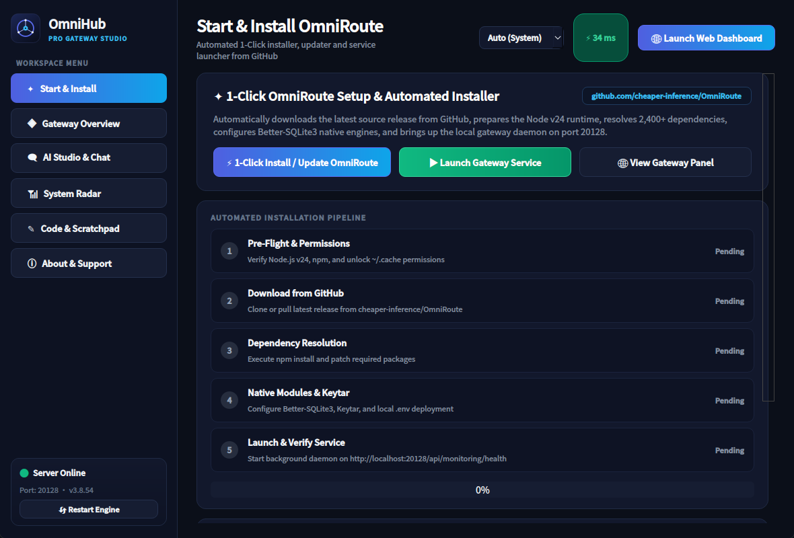

# 🪐 OmniHub

**Precision AI Gateway, 1-Click OmniRoute Installer & System Studio for Linux & Deepin OS**

Designed and built by **[Md Sojib Hossain](https://github.com/sojibcreates-maker)** ([SojibLabs](https://facebook.com/hossain.sojibs)).



---

## 🌟 Overview

**OmniHub** is a native desktop control center for AI routing and system telemetry. It provides:
1. **Automated 1-Click OmniRoute Gateway Installer** right from GitHub.
2. **AI Studio & Chat** supporting 389+ AI models (OpenAI, Anthropic, Gemini, Groq, Ollama, DeepSeek, etc.) with real-time SSE streaming.
3. **System Radar** monitoring live CPU, RAM, disk usage, and host specifications.
4. **Developer Scratchpad & Utilities** with JSON formatter, Base64 encoder/decoder, and token counter.
5. **Adaptive Theme Engine** with seamless Light & Dark theme switching and automatic desktop appearance detection.

---

## ✨ Features

- **🚀 1-Click Gateway Setup**: Clones, installs, configures, and starts OmniRoute as a daemon with live progress tracking and log streaming.
- **💬 AI Studio**: Stream prompts and chat completions through your local or remote OmniRoute endpoints.
- **⚡ System Radar**: Live resource monitoring for CPU load, RAM allocation, and disk capacity.
- **🛠️ Utility Drawer**: Rapid JSON prettify/minify, Base64 encoding/decoding, and token estimation.
- **🌗 Native Theme Support**: Supports both Dark Mode and Light Mode with custom vector icons and accents.
- **📌 Deepin OS & Linux Integration**: Integrated system tray icon, notifications, and desktop shortcut pinned to dock.

---

## 🚀 Quick Start

### 1. Requirements
- Python 3.10+
- Linux (Deepin OS, Ubuntu, Debian, Fedora, Arch, etc.)

### 2. Automatic Installation
Clone the repository and run the installer:
```bash
git clone https://github.com/sojibcreates-maker/OmniHub.git
cd OmniHub
chmod +x install.sh
./install.sh
```

### 3. Manual Installation
```bash
pip install -r requirements.txt
python3 main.py
```

---

## ⌨️ Shortcuts

| Shortcut | Action |
| --- | --- |
| `Ctrl + K` | Open Command Palette |
| `Ctrl + 1 … 6` | Switch Sections |
| `Ctrl + D` | Open OmniRoute Web Dashboard |
| `Ctrl + R` | Restart AI Gateway Service |
| `Ctrl + Shift + T` | Toggle Light / Dark Theme |
| `Ctrl + Q` | Quit Application |

---

## ☕ Support & Donations

If you find OmniHub useful, please consider supporting the development:

- ☕ **Ko-fi**: [ko-fi.com/sojibhossain](https://ko-fi.com/sojibhossain)
- 💖 **SupportKori**: [supportkori.com/sojib](https://www.supportkori.com/sojib)
- 🌐 **Facebook**: [facebook.com/hossain.sojibs](https://www.facebook.com/hossain.sojibs)
- 💻 **GitHub**: [github.com/sojibcreates-maker](https://github.com/sojibcreates-maker)

---

## 📄 License

Created by **Md Sojib Hossain (SojibLabs)**. Distributed for personal and community use.
